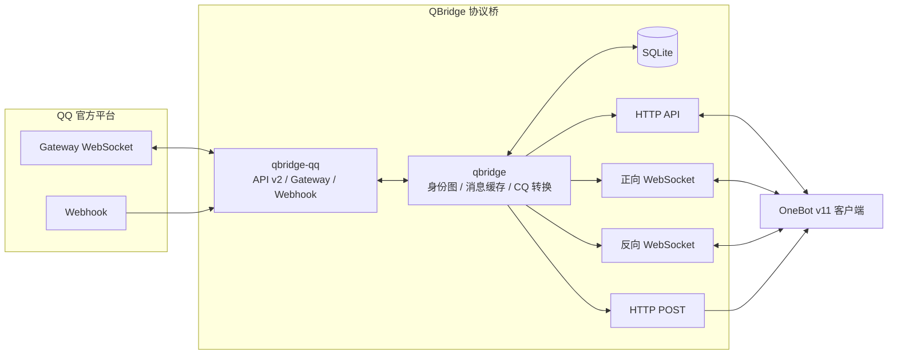

# QBridge

**QQ 官方机器人 ↔ OneBot v11 的 Rust 协议桥。**

QQ 官方机器人使用 OpenID、官方消息 ID 和专用富媒体接口，而大量 QQ 机器人插件仍然基于 OneBot v11。QBridge 负责在两者之间完成协议转换、ID 映射、消息缓存和事件分发，让现有 OneBot v11 客户端可以直接连接 QQ 官方机器人，而不需要 reverse QQ 协议。



接口级参数、事件和错误码见 [API_MAPPING.md](API_MAPPING.md)。

当前支持群聊和单聊（C2C），不包含频道和讨论组。

## 为什么使用 QBridge

如果你已经有基于 OneBot v11 的机器人框架或插件，想从 NapCat、Lagrange 等非官方协议端迁移到 QQ 官方机器人，又不想重写整套业务代码，直接用 QBridge 替换原来的 OneBot v11 协议端即可：

- **上游切换为 QQ 官方机器人**：不依赖非官方逆向协议端，降低风控和协议失效带来的维护成本。
- **下游保持 OneBot v11 接入**：现有框架和插件只需改连 QBridge，无需重新适配 QQ 官方接口。
- **开箱替代原有协议端**：独立二进制运行，无需挂载桌面 QQ 客户端或复杂运行环境。

## 能力

### 传输

- [x] HTTP API
- [x] 正向 WebSocket
- [x] 反向 WebSocket
- [x] HTTP POST 上报
- [x] 心跳与 lifecycle
- [x] 异步动作队列与限速队列

### 消息

- [x] 私聊文本
- [x] 群聊文本
- [x] 图片
- [x] 语音
- [x] 视频
- [x] 文件
- [x] Markdown
- [x] 自定义键盘
- [x] 合并转发
- [x] 原生引用
- [x] 被动回复
- [x] 主动消息
- [x] 撤回机器人消息
- [x] 撤回群成员消息（需权限）
- [x] 快速操作
- [x] 本地文件分片上传
- [x] 群聊 `@全体成员`

### 群管理

- [x] 群信息
- [x] 群成员信息
- [x] 群成员列表
- [x] 群列表
- [x] 好友列表
- [x] 单人禁言
- [x] 踢人
- [x] 踢人并拉黑
- [x] 入群申请审批
- [x] 入群申请列表
- [x] 机器人群内状态
- [x] 群黑名单查询
- [x] 群黑名单增删
- [x] 入群自动审批策略管理
- [x] 头像
- [x] 机器人分享链接
- [x] C2C 自定义菜单
- [x] 指令面板
- [ ] 群管理员设置
- [ ] 群名片设置
- [ ] 群名称设置
- [ ] 退群
- [ ] 群专属头衔
- [ ] 全员禁言

### 事件

- [x] `message.private`
- [x] `message.group`
- [x] 好友增加/删除
- [x] 机器人入群/退群
- [x] 群成员加入/退出
- [x] 入群申请
- [x] 群消息推送开启/关闭
- [x] 单聊消息推送开启/关闭
- [x] 按钮互动
- [x] heartbeat
- [x] lifecycle
- [ ] `message.guild`
- [ ] 好友请求
- [ ] 群消息撤回通知

### 扩展 CQ 码

- [x] `[CQ:file]`
- [x] `[CQ:card]`
- [x] `[CQ:input_notify]`
- [x] `[CQ:stream]`
- [x] `[CQ:active]`
- [x] `[CQ:wakeup]`
- [x] `[CQ:avatar]`
- [x] `[CQ:group_info]`
- [x] `[CQ:member]`
- [x] `[CQ:set_group]`
- [ ] `[CQ:tts]`
- [ ] `[CQ:face]`
- [ ] `[CQ:share]`
- [ ] `[CQ:music]`
- [ ] `[CQ:xml]`
- [ ] `[CQ:json]`

### 标准动作

已实现：

- [x] `send_private_msg`
- [x] `send_group_msg`
- [x] `send_msg`
- [x] `delete_msg`
- [x] `get_login_info`
- [x] `get_status`
- [x] `get_version_info`
- [x] `get_group_info`
- [x] `get_group_list`
- [x] `get_group_member_info`
- [x] `get_group_member_list`
- [x] `get_friend_list`
- [x] `set_group_ban`
- [x] `set_group_kick`
- [x] `set_group_add_request`
- [x] `can_send_image`
- [x] `can_send_record`
- [x] `clean_cache`
- [x] `set_restart`
- [x] `.handle_quick_operation`

未实现：

- [ ] `get_online_clients`
- [ ] `get_forward_msg`
- [ ] `send_like`
- [ ] `set_group_whole_ban`
- [ ] `set_group_anonymous_ban`
- [ ] `set_group_admin`
- [ ] `set_group_anonymous`
- [ ] `set_group_card`
- [ ] `set_group_name`
- [ ] `set_group_leave`
- [ ] `set_group_special_title`
- [ ] `set_friend_add_request`
- [ ] `get_stranger_info`
- [ ] `get_group_honor_info`
- [ ] `get_cookies`
- [ ] `get_csrf_token`
- [ ] `get_credentials`
- [ ] `get_record`

扩展动作：

- [x] `send_to_group`
- [x] `send_private_msg_wakeup`
- [x] `delete_group_msg`
- [x] `get_group_ban`
- [x] `send_private_forward_msg`
- [x] `send_group_forward_msg`
- [x] `send_forward_msg`
- [x] `get_msg`
- [x] `get_image`
- [x] `put_interaction`
- [x] `get_avatar`
- [x] `get_robot_share_link`
- [x] `get_group_join_request_list`
- [x] `get_group_bot_state`
- [x] `get_group_member_blacklist`
- [x] `set_group_member_blacklist`
- [x] `join_approval_strategy_create`
- [x] `join_approval_strategy_list`
- [x] `join_approval_strategy_update`
- [x] `join_approval_strategy_execute`
- [x] `join_approval_strategy_whitelist`
- [x] `join_approval_strategy_delete`
- [x] `get_custom_menu`
- [x] `set_custom_menu`
- [x] `get_panel_list`
- [x] `create_panel`
- [x] `get_panel`
- [x] `set_panel`
- [x] `delete_panel`
- [x] `set_panel_target`

不支持的标准动作会返回 `UNSUPPORTED_ACTION`，不支持的 CQ 码会返回 `UNSUPPORTED_SEGMENT`，不会用文本伪造成功。

## 环境要求

- Rust 1.88 或更新版本
- 一个已开通 QQ 官方机器人 API 的应用
- 按需开通 Markdown、群管理、素材上传、群成员等平台权限

部分群成员接口需要 QQ 开放平台额外授权。没有权限时接口会返回平台错误，通常为 `11253 应用无接口访问权限`。

## 快速开始

```sh
cargo build --release --locked
cp qbridge.example.toml qbridge.toml
```

参照 `qbridge.example.toml` 填写 `qbridge.toml`，检查通过后再启动：

```sh
target/release/qbridge --check
target/release/qbridge
```

### 常用命令

下表用 `qbridge` 代表可执行文件。源码构建后用 `target/release/qbridge`；在发布包解压目录中用 `./qbridge`。

| 用途 | 命令 | 说明 |
| --- | --- | --- |
| 启动 | `qbridge` | 读取当前目录的 `qbridge.toml` 并启动服务 |
| 指定配置启动 | `qbridge --config ./bot.toml` | 使用指定的配置文件 |
| 检查配置 | `qbridge --check` | 校验配置和所需的环境变量，不连接 QQ，也不启动服务 |
| 检查指定配置 | `qbridge --check --config ./bot.toml` | 只校验指定的配置文件及其所需的环境变量 |
| 查看版本 | `qbridge --version` 或 `qbridge -V` | 输出程序版本，不读取配置 |
| 查看帮助 | `qbridge --help` 或 `qbridge -h` | 显示命令用法，不读取配置 |

发布包的版本来自 Git tag，例如 `v0.1.0-beta.2` 显示为 `qbridge 0.1.0-beta.2`；本地构建默认显示 `qbridge 0.0.0-dev`。

## 下游接口

| 接口 | 地址 | 说明 |
| --- | --- | --- |
| HTTP API | `http://{http.bind}/{action}` | 支持 JSON、query 和表单；也接受尾斜线 |
| 正向 WebSocket | `ws://{forward_ws.bind}/`、`/api`、`/event` | `/` 同时收发，`/api` 只发动作，`/event` 只收事件 |
| 反向 WebSocket | `reverse_ws[].url` | 连接时发送 `X-Self-ID`、`X-Client-Role`，配置了 `access_token` 时发送 `Authorization: Bearer` |
| HTTP POST | `http_post[].url` | 支持 `X-Signature` HMAC-SHA1 签名 |

HTTP 和 WebSocket 支持：

```text
Authorization: Bearer <token>
?access_token=<token>
```

HTTP API 的动作参数支持 JSON、query 和表单；HTTP POST 上报事件使用 JSON。

至少配置一种下游传输。仅启用反向 WebSocket 或 HTTP POST 时，可同时省略 `[http]` 与 `[forward_ws]`。HTTP POST 单独启用时，动作通过响应体的快速操作触发。

## 行为说明

- **被动回复**：群聊每条入站消息最多 5 次，单聊最多 4 次；QBridge 自动维护 `msg_seq`。
- **主动消息**：消息参数带 `active: true` 时跳过被动上下文。
- **消息缓存**：入站和机器人发出的消息都会写入 SQLite，供 `get_msg`、`get_image`、引用和撤回使用；TTL 与清理间隔可在 `[cache]` 中配置，入站消息缓存时长与 QQ 被动回复窗口解耦。
- **身份映射**：QQ OpenID 只存在数据库中；同一个 OpenID 在私聊和群聊中复用同一个实体 ID。
- **profile 缓存**：好友列表和群成员列表会读取昵称/名片缓存，减少重复接口调用。
- **大文件**：本地媒体流式读取，按 QQ `upload_prepare`/分片流程上传。
- **Markdown 图片**：支持 ``；合并转发节点图片会读取真实宽高后写入。
- **群聊 @全体**：`[CQ:at,qq=all]` 转换为 `<qqbot-at-everyone />`。

## 已知限制

- 不实现频道和讨论组。
- `get_record` 不做语音转码。
- 部分群管理动作仍返回 `UNSUPPORTED_ACTION`。
- 主动消息不预检 QQ 平台配额和权限。
- 群聊 @全体要求机器人是群管理员，且每个群每天只能发送一次。
- QQ 的 `GROUP_MEMBER_ADD` / `GROUP_MEMBER_REMOVE` 事件不包含操作者，无法仅凭事件区分群主操作和成员主动退出。
- `get_msg` / `get_image` 只查询本地缓存，不访问 QQ 历史消息。
- HTTP POST 使用内存队列和有限重试，队列满、重试耗尽或进程退出时可能丢失事件。可通过 `get_status` 查看队列积压和丢弃计数。
- Gateway 的持久化 Resume 检查点在桥接处理与本地分发尝试之后推进。若进程在消息写入缓存后、分发前退出，缓存去重仍可能拦截重放。
- 自动测试只使用本地模拟 QQ 服务，发布前仍需真实 QQ 验收。

## 数据库

默认数据库：

```text
data/qbridge.sqlite
```

数据库保存身份、消息缓存、Gateway 会话和 profile 缓存。

数据库结构版本独立于程序版本记录；结构变化时不会自动迁移，需要删除数据库后重新建立。删除后消息缓存和本地数字 ID 会重新生成。

## 开发

```sh
cargo fmt --all --check
cargo clippy --workspace --all-targets --locked -- -D warnings
cargo test --workspace --locked
```

发布 CI 从 Git tag 提取版本，通过编译期环境变量 `QBRIDGE_VERSION` 注入，无需手动修改 `Cargo.toml`。在支持 POSIX 语法的 shell 中，也可为本地构建指定版本：

```sh
QBRIDGE_VERSION=0.1.0-beta.2 cargo build --release --locked
```

工作区：

- `qbridge-ob11`：OneBot v11 类型、CQ 编解码和事件序列化
- `qbridge-qq`：QQ 官方 API v2、Gateway 和 Webhook 客户端
- `qbridge`：存储、协议转换、服务端和程序入口
